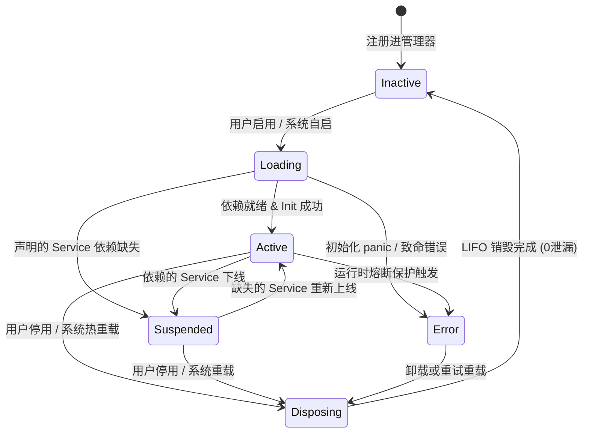

# Ani-Go 插件开发规范与现代化架构白皮书 (Plugin Specification & Architecture Blueprint)

> **版本**：v0.6.2 (DSH / Cordis 架构演进版)  
> **适用范围**：Ani-Go 微内核插件生态系统  
> **核心原则**：纯 Go 编译、零 CGO、零外部运行时、常驻内存 < 30MB、空载 CPU 0.0%、微内核主干纯粹

---

## 1. 架构哲学与演进背景

Ani-Go 严格遵循**微内核架构（Microkernel Architecture）**。微内核核心（Core）严格收敛于追番主干五步流水线闭环：

```
RSS 订阅抓取 ──► 标题与集数消歧 ──► 下载器调度 (qB/Aria2) ──► 规范重命名与硬链接 ──► 交付 Jellyfin 播放
```

主干之外的所有辅助能力（18 平台通知中心、Bangumi/TMDB 元数据映射、本地 NFO 刮削、规范重命名、第三方数据导入等）均以**插件（Plugin）**形态存在。

### 1.1 DSH / Cordis 架构范式引入

在现代高可扩展系统架构（如 DeepSeek Harness (DSH) 与 Cordis）中，插件系统不再仅仅是「事件监听器回调」的简单堆叠，而是具备以下核心特质的**时空可组合运行时（Spatiotemporal Composable Runtime）**：

1. **时空可组合性（Spatiotemporal Composability）**：
   - **空间维度（Spatial）**：每个插件运行在从根上下文派生出的独立作用域上下文（`PluginContext` / Context Fork）中，隔离内部状态、资源清单与日志命名空间。
   - **时间维度（Temporal）**：系统在运行生命周期的任意时刻均可加载、激活、挂起、热重载或注销插件，无需重启核心服务，亦不干扰其他并发业务。
2. **可逆副作用与自动销毁（Reversible Effects & Disposable Pattern）**：
   - 插件产生的任何副作用（注册事件监听、启动后台协程、挂载流水线拦截器、占用文件句柄或定时器），均**强制关联可撤销闭包（`Disposable`）**。
   - 插件停用时，上下文自动以 **LIFO（后进先出）逆序**执行全部销毁函数，从根源上根绝协程泄漏、事件重复触发与内存游离对象。
3. **控制反转与声明式服务依赖（IoC & Dependency Injection）**：
   - 插件无需手动刺探全局单例，而是通过 `Dependencies()` 声明所需服务（如 `database`、`downloader`、`metadata`）。
   - 容器基于拓扑排序进行按需装配；当依赖服务异常离线时，插件自动平滑退入 `Suspended`（挂起）态，待服务恢复后自动重新激活。
4. **双轨架构：流水线拦截器（Pipeline Interceptors） vs 事件广播（EventBus）**：
   - **同步中继轨（Interceptors / Middlewares）**：位于微内核主干关键节点（如番剧命名、文件过滤），允许插件同步检查、修改、富化载荷或实行一票否决（Short-circuit）。
   - **异步广播轨（EventBus Pub/Sub）**：纯单向解耦广播，用于遥测监控、日志审计、Webhook 外部通知，具备 Panic 隔离与非阻塞投递。
5. **严格的插件生命周期状态机（Lifecycle State Machine）**：
   - 废除原有的二元 `bool` 开关，引入完整的六状态机：`Inactive` ➔ `Loading` ➔ `Active` ➔ `Suspended` ➔ `Error` ➔ `Disposing`，并向 API 与 MCP 控制层透明暴露健康状态。

---

## 2. 架构对比与演进矩阵 (Architecture Contrast Matrix)

下表对比了 Ani-Go 早期插件机制、现代 DSH / Cordis 架构范式与 Ani-Go 本次演进落地的纯 Go 蓝图设计：

| 架构维度 | Ani-Go 早期插件机制 (v0.5.x) | DSH / Cordis 范式 (TS/Dynamic) | Ani-Go 现代化演进蓝图 (v0.6.2+) |
|---|---|---|---|
| **语言与运行时** | 纯 Go，零 CGO，轻量单二进制 | Node.js / TypeScript，依赖 GC 与动态原型链 | **100% 纯 Go，零 CGO，零第三方重量级框架** |
| **内存与 CPU 基准** | 内存 ~25MB，空载 0.0% CPU | 常驻 80MB~200MB+（受 V8 引擎限制） | **内存严格保持在 15MB~30MB，空载 CPU 恒为 0.0%** |
| **资源注销方式** | 手动记录 `subID`，在 `Stop()` 中手工调用 `bus.Unsubscribe`，易遗漏导致泄漏 | 自动关联 `ctx.on('dispose', ...)` 回调栈 | **`PluginContext.OnDispose(fn)` 闭包栈，停用时自动 LIFO 执行** |
| **协程管理** | 插件自行 `go func()`，易发生未捕获 Panic 或进程退出阻塞 | 框架层托管 Promise / EventLoop 微任务 | **`PluginContext.Go(worker)` 托管协程，内置 recover 隔离与停用信号通知** |
| **服务与状态解耦** | 插件直接 import 并访问全局 `database.DB` 或单例，耦合紧密 | 全量 IoC 容器，`ctx.inject` 按需动态注入 | **轻量 `ServiceRegistry`，通过 `ctx.GetService()` 安全访问，禁止直连私有全局** |
| **主干干预能力** | 仅能在事件发生后被动感知（广播滞后），命名规则硬编码于核心 | 洋葱模型 Middleware，支持同步请求/响应拦截与修改 | **双轨制：核心阶段暴露轻量 `Interceptor` 链，后置通知走 `EventBus`** |
| **生命周期状态** | 二元状态：`Enabled (true/false)`，无法感知内部故障 | 丰富状态：加载、运行、依赖等待、故障隔离 | **六状态机：`Inactive` / `Loading` / `Active` / `Suspended` / `Error` / `Disposing`** |
| **动态配置与自描述** | 散落在 `settings` 键值表中，无类型约束 | 声明式 Schema（JSON Schema / Formily） | **`ConfigSchema` 结构化声明元数据，支持前端动态表单与默认值校验** |

---

## 3. 现代化核心机制深度解析

```
                   ┌────────────────────────────────────────┐
                   │          Ani-Go Microkernel            │
                   │  (Pure Go / Zero CGO / Memory < 30MB)  │
                   └──────────────────┬─────────────────────┘
                                      │
            ┌─────────────────────────┴────────────────────────┐
            ▼                                                  ▼
┌───────────────────────┐                          ┌────────────────────────┐
│  Synchronous Pipeline │                          │  Asynchronous EventBus │
│ (Interceptors Chain)  │                          │    (Pub/Sub Telemetry) │
├───────────────────────┤                          ├────────────────────────┤
│ [Filter Interceptors] │                          │ EventDownloadCompleted │
│ [Naming Interceptors] │                          │ EventFileOrganized     │
│ [Parser Interceptors] │                          │ EventSubscriptionAdded │
└───────────┬───────────┘                          └───────────┬────────────┘
            │                                                  │
            │                  PluginContext                   │
            │       (Scoped Hierarchy / Isolated Fork)         │
            ├──────────────────────────────────────────────────┤
            │  • OnDispose(fn) ───► LIFO Teardown Stack        │
            │  • Go(worker)   ───► Goroutine & Panic Isolation │
            │  • Inject(deps) ───► Service Registry Binding   │
            │  • Logger()     ───► Scoped Structured Logging   │
            └──────────────────────────┬───────────────────────┘
                                       │
            ┌──────────────────────────┴────────────────────────┐
            ▼                                                   ▼
┌───────────────────────┐                           ┌───────────────────────┐
│ BuiltIn Plugin Engine │                           │ Custom Webhook Plugin │
│   (In-Process Go)     │                           │   (HTTP Push, HMac)   │
└───────────────────────┘                           └───────────────────────┘
```

### 3.1 作用域上下文与可逆副作用 (PluginContext & Reversible Effects)

每一个插件在激活时，插件管理器都会为其创建专属的 `PluginContext`。`PluginContext` 继承标准库 `context.Context`，并在其上提供**可逆副作用闭包注册表**：

```go
package plugin

import (
	"context"
	"log"

	"github.com/xiaoyueRX/Ani-Go/internal/core"
)

// Disposable 可撤销副作用闭包函数
type Disposable func()

// PluginContext 插件专属作用域上下文契约
type PluginContext interface {
	context.Context

	// 插件元数据与作用域标识
	PluginID() string

	// 1. 可逆副作用生命周期管理
	OnDispose(fn func())
	Dispose() // LIFO 逆序释放所有已注册资源

	// 2. 协程安全托管（自动绑定 Context 取消，内置 defer recover 隔离）
	Go(worker func(ctx context.Context))

	// 3. 自动退订的事件监听（插件注销时无需手动退订）
	Subscribe(eventType string, handler func(ev core.Event))

	// 4. 控制反转服务获取与发布
	GetService(serviceType core.ServiceType) (interface{}, bool)
	MustGetService(serviceType core.ServiceType) interface{}
	ProvideService(serviceType core.ServiceType, impl interface{}) Disposable

	// 5. 流水线拦截中继挂载（自动注销）
	RegisterNamingInterceptor(priority core.HookPriority, name string, handler core.HookFunc)
	RegisterFilterInterceptor(priority core.HookPriority, name string, handler core.HookFunc)

	// 6. 作用域隔离日志
	Logger() *log.Logger
}
```

#### 零泄漏保证原理：
当用户在前端点击「停用」插件或系统热重载时，管理器调用 `ctx.Dispose()`：
1. 立即触发 `context.CancelFunc`，向所有由 `ctx.Go(...)` 派生的工作协程发出退出广播；
2. 逆序遍历内部 `disposables` 切片，执行所有退订逻辑、网络套接字关闭逻辑与内存清理钩子；
3. 将内部资源指针置 `nil`，交由 Go 运行时垃圾回收，完全达成 **0 协程泄漏、0 事件监听残留、0 额外 CPU 占用**。

### 3.2 控制反转与服务注册表 (IoC & Service Registry)

为了打破插件直接依赖全局单例变量（如 `database.DB`）所产生的紧耦合死结，引入轻量级线程安全服务注册表：

```go
type ServiceRegistry interface {
	Register(serviceType core.ServiceType, impl interface{}) Disposable
	Get(serviceType core.ServiceType) (interface{}, bool)
	Watch(serviceType core.ServiceType, callback func(available bool)) Disposable
}
```

系统核心服务（`database`、`config`、`downloader`、`organizer`、`metadata`、`eventbus`、`ai`）在系统初始化时注册到服务中心；插件声明其所需要的依赖项：
```go
func (p *MyPlugin) Dependencies() []core.ServiceType {
    return []core.ServiceType{core.ServiceDB, core.ServiceMetadata}
}
```
当系统初始化或某项服务热重载时，插件管理器会自动解析依赖拓扑。若某依赖服务不可用，插件将自动转入 `Suspended` 状态并停止处理任务，避免因依赖空指针引发运行时崩溃。

### 3.3 双轨处理机制：流水线拦截器 vs 事件广播

Ani-Go 确立了清晰的**双轨分工规范**：

```
+-------------------------------------------------------------------------+
| [数据流水线] RSS 抓取 ──► 过滤检查 ──► 标题解析 ──► 整理归档 ──► 媒体入库 |
+-------------------------------------------------------------------------+
           ▲                 ▲                ▲
           │                 │                │
  [Filter Interceptor]       │      [Naming Interceptor]
     (同步中继/一票否决)       │         (同步富化/修改路径)
                             │
               [Parser Interceptor] (自愈消歧)
                             │
                             ▼
+-------------------------------------------------------------------------+
| [事件广播总线] EventBus (Pub/Sub: Async, Fire-and-Forget, Safe-Isolated)|
+-------------------------------------------------------------------------+
    │                        │                         │
    ▼                        ▼                         ▼
[Webhooks]           [Audit Logger]           [Notification Center]
```

- **流水线拦截器（Pipeline Interceptors）**：
  - 适用场景：需要在核心逻辑执行过程中**同步介入**。例如在 RSS 入库前拦截过滤广告种子（`FilterInterceptor`），或在硬链接生成前动态计算符合 Plex 格式的目录命名（`NamingInterceptor`）。
  - 执行机制：按优先级 `HookPriority` 瀑布流串行执行，支持修改入参或直接阻断后续操作。
- **事件总线广播（EventBus Broadcasts）**：
  - 适用场景：事件已经发生后的**解耦广播通知**。例如下载完成（`download.completed`）、整理成功（`file.organized`）。
  - 执行机制：多协程并发投递，单订阅者崩溃不影响其他订阅者，投递超时或错误不阻断主干。

### 3.4 插件生命周期六状态机 (Lifecycle State Machine)

插件运行时状态由单一布尔值重构为有限状态机：



| 状态 | 枚举值 | 说明 |
|---|---|---|
| **Inactive (未激活)** | `inactive` | 插件已在系统中注册，但处于完全关闭状态。不占用协程与事件句柄，内存仅保留元数据。 |
| **Loading (装载中)** | `loading` | 管理器正在校验插件配置 Schema，并检查声明的 `Dependencies()` 是否在注册表中就绪。 |
| **Active (运行中)** | `active` | 插件已成功调用 `Init(ctx)`，事件订阅与流水线拦截器已生效，后台工作协程受控运行。 |
| **Suspended (挂起)** | `suspended` | 插件已开启，但其声明的某一核心服务暂时离线。插件挂起全部副作用，待依赖就绪后自动唤醒。 |
| **Error (故障隔离)** | `error` | 插件在初始化或运行阶段触发 panic 或致命错误，熔断器将其隔离并记录堆栈，确保主干安全。 |
| **Disposing (销毁中)** | `disposing` | 正在按 LIFO 逆序依次执行注销函数与上下文取消，释放完毕后转移至 `Inactive`。 |

---

## 4. 插件标准接口与类型契约

### 4.1 核心数据结构

```go
package plugin

import "github.com/xiaoyueRX/Ani-Go/internal/core"

// PluginState 插件生命周期状态枚举
type PluginState string

const (
	StateInactive  PluginState = "inactive"
	StateLoading   PluginState = "loading"
	StateActive    PluginState = "active"
	StateSuspended PluginState = "suspended"
	StateError     PluginState = "error"
	StateDisposing PluginState = "disposing"
)

// ConfigField 配置项元数据描述（支持前端动态渲染设置表单）
type ConfigField struct {
	Key         string      `json:"key"`                   // 配置项键名
	Label       string      `json:"label"`                 // 显示名称
	Description string      `json:"description"`           // 字段说明提示
	Type        string      `json:"type"`                  // "string" | "number" | "boolean" | "select"
	Default     interface{} `json:"default,omitempty"`     // 默认值
	Options     []string    `json:"options,omitempty"`     // 选项列表（针对 select）
	Required    bool        `json:"required"`              // 是否必填
}

// PluginInfo 插件元数据（前端展示与 API 交互的核心契约）
type PluginInfo struct {
	ID          string        `json:"id"`                    // 唯一标识符，例如 "nfo_scraper"
	Name        string        `json:"name"`                  // 插件名称
	Description string        `json:"description"`           // 插件功能简介
	Version     string        `json:"version"`               // 语义化版本号
	Author      string        `json:"author"`                // 作者标识
	AuthorURL   string        `json:"author_url,omitempty"`  // 作者主页
	Icon        string        `json:"icon"`                  // Lucide 图标名称
	State       PluginState   `json:"state"`                 // 插件六状态
	LastError   string        `json:"last_error,omitempty"`  // 发生故障时的错误信息摘要
	IsBuiltIn   bool          `json:"is_builtin"`            // 是否内置官方插件
	Type        string        `json:"type"`                  // "builtin" / "webhook"
	URL         string        `json:"url,omitempty"`         // 自定义 Webhook 回调地址
	Secret      string        `json:"secret,omitempty"`      // Webhook 签名密钥
	Events      []string      `json:"events"`                // 关注的事件类型列表
	ConfigSchema []ConfigField `json:"config_schema,omitempty"` // 动态配置 Schema
}

// ModernBuiltInPlugin 现代化内建插件接口契约
type ModernBuiltInPlugin interface {
	// GetInfo 返回插件静态元数据
	GetInfo() PluginInfo

	// Dependencies 声明所需的强依赖服务（可为空）
	Dependencies() []core.ServiceType

	// Init 初始化并挂载插件逻辑（所有监听与协程必须通过 ctx 注册）
	Init(ctx PluginContext) error
}
```

---

## 5. 低资源环境保障规范 (Resource Budget Guarantee)

Ani-Go 专为 J1900、N3450、树莓派等轻量 NAS 与边缘工控设备优化，插件系统必须恪守以下性能红线：

1. **绝对禁止 CGO**：
   - 必须保持 `CGO_ENABLED=0` 静态编译通过，严禁引入 SQLite C 库或任何外部 C 动态链接库。
2. **零外部重型运行时**：
   - 严禁为了「插件扩展」而内嵌 Node.js、V8、Python 解释器或重型 JVM 容器；
   - 所有官方与高级扩展均采用静态内建编译或轻量标准 Webhook 协议分发。
3. **常驻内存与空载开销基准**：
   - 空载常驻内存（全量内置插件开启但处于静息待命时）：**严格控制在 15MB ~ 30MB 之间**；
   - 处于待命状态时，插件协程必须处于 channel 阻塞监听或休眠状态，**CPU 占用率恒定为 0.0%**；
4. **内存分配优化**：
   - 拦截器与事件传递尽量使用指针或浅拷贝，避免大数组与高频深拷贝带来的垃圾回收压力。

---

## 6. 五分钟实战：编写一个现代化插件

以下示例演示如何基于全新的 `PluginContext` 编写一个**在文件整理时输出审计日志并提供规范化命名拦截**的极简现代插件：

```go
package plugin

import (
	"context"
	"fmt"
	"time"

	"github.com/xiaoyueRX/Ani-Go/internal/core"
)

// AuditAndNamingPlugin 现代化示例插件
type AuditAndNamingPlugin struct{}

func (p *AuditAndNamingPlugin) GetInfo() PluginInfo {
	return PluginInfo{
		ID:          "audit_and_naming",
		Name:        "整理审计与命名中继插件",
		Description: "基于 PluginContext 的现代化架构范例：同步拦截文件命名并异步记录审计流水。",
		Version:     "1.0.0",
		Author:      "Ani-Go Team",
		Icon:        "ShieldCheck",
		IsBuiltIn:   true,
		Type:        "builtin",
		Events:      []string{core.EventFileOrganized},
	}
}

// Dependencies 声明本插件所需的核心服务
func (p *AuditAndNamingPlugin) Dependencies() []core.ServiceType {
	return []core.ServiceType{core.ServiceEventBus}
}

// Init 核心装载入口：一切资源与副作用均注册到 ctx
func (p *AuditAndNamingPlugin) Init(ctx PluginContext) error {
	logger := ctx.Logger()
	logger.Printf("🚀 插件已启动，作用域: %s", ctx.PluginID())

	// 1. 注册流水线同步拦截器：规范化重命名（自动随插件停用而注销）
	ctx.RegisterNamingInterceptor(core.PriorityNormal, "audit_naming", func(c context.Context, input interface{}) (interface{}, error) {
		in, ok := input.(core.NamingHookInput)
		if !ok {
			return nil, fmt.Errorf("无效的命名输入")
		}
		// 动态在文件名前追加 [AniGo-Verified]
		return core.NamingHookOutput{
			RenderedPath: "[AniGo-Verified] " + in.RenderedPath,
			Cancel:       false,
		}, nil
	})

	// 2. 注册异步事件监听：记录审计日志（无需记录 subID，停用时自动退订）
	ctx.Subscribe(core.EventFileOrganized, func(ev core.Event) {
		logger.Printf("📝 [AUDIT EVENT] 捕获归档事件: %+v", ev.Payload)
	})

	// 3. 启动受控后台工作协程：自带 panic recover 与 context 退出信号
	ctx.Go(func(workerCtx context.Context) {
		ticker := time.NewTicker(10 * time.Minute)
		defer ticker.Stop()

		for {
			select {
			case <-workerCtx.Done():
				logger.Println("🛑 后台协程收到退出信号，安全退出")
				return
			case t := <-ticker.C:
				logger.Printf("⏱️ [定时心跳] 插件正常运行中: %s", t.Format(time.RFC3339))
			}
		}
	})

	// 4. 注册自定义资源清理钩子（可选）
	ctx.OnDispose(func() {
		logger.Println("🧹 正在释放专属缓存与临时文件...")
	})

	return nil
}
```

### 极简注册流程：
只需在 `internal/plugin/manager.go` 中加入注册：
```go
m.RegisterBuiltIn(&AuditAndNamingPlugin{})
```
无需在 `Stop()` 方法中手写 50 行退订和协程取消逻辑，框架将自动保障该插件在开启、关闭、热重载时 **零泄漏、零残留**。

---

## 7. 自定义插件 (Webhooks) 与外部扩展

对于不愿修改 Go 源码重新编译的外部用户，Ani-Go 提供了基于 HTTP 的外部集成方案：

### 7.1 Webhook 事件推送协议
用户在前端「设置 -> 插件管理」中添加自定义 Webhook 记录，登记目标 `URL`、`Secret` 及关心的事件列表。

```json
{
  "event": "download.completed",
  "timestamp": 1750000000,
  "plugin_id": "my_discord_bot",
  "payload": {
    "torrent_hash": "a1b2c3d4...",
    "anime_title": "葬送的芙莉莲",
    "episode": 12
  }
}
```

**请求安全规范**：
- **签名校验**：若配置了 `secret`，请求头将附带 `X-AniGo-Signature: sha256=<HMAC-SHA256>`，接收端可验证载荷合法性；
- **私网阻断（SSRF 防御）**：默认禁止向 `127.0.0.1`、`10.0.0.0/8`、`172.16.0.0/12`、`192.168.0.0/16` 及私有云元数据服务发起请求（测试环境除外）；
- **超时与熔断**：统一超时 10 秒，在隔离 goroutine 中异步发送，网络拥堵绝不拖滞主追番流水线。

### 7.2 MCP (Model Context Protocol) 联动展望
已在 `internal/mcp/` 实现了基于 SSE 与 Bearer Token 的原生 MCP 服务器。插件可通过声明 MCP 工具描述，使外部 Claude、Cursor 等 AI 智能体可直接感知插件状态并执行调度操作。

---

## 8. 平滑迁移与向后兼容设计 (Migration & Compatibility)

为了保障系统平稳演进，避免一次性破坏已有内置插件，设计了**双向适配器（Bi-directional Adapter）**：

1. **旧版插件无缝兼容**：
   - 现有的 `BuiltInPlugin`（实现 `Init(bus, ctx)` 与 `Stop(bus)`）可通过 `AdaptLegacyPlugin(p BuiltInPlugin) ModernBuiltInPlugin` 自动包装为现代插件；
   - 适配器在 `Init(ctx PluginContext)` 中自动提取总线调用旧版 `Init`，并将旧版 `Stop` 注册进 `ctx.OnDispose(...)` 中；
2. **渐进式重构路径**：
   - 第一阶段：落地 `PluginContext` 与 `ServiceRegistry`，重构 `Manager` 状态机；
   - 第二阶段：将内置插件（`MetadataMapping`、`GeekNaming`、`ExtendedNotifiers`、`NFOScraper`）逐一迁移至 `PluginContext` 声明式风格；
   - 第三阶段：前端 `SettingsPage.vue` 对接全新的六状态健康监控与动态配置表单。
