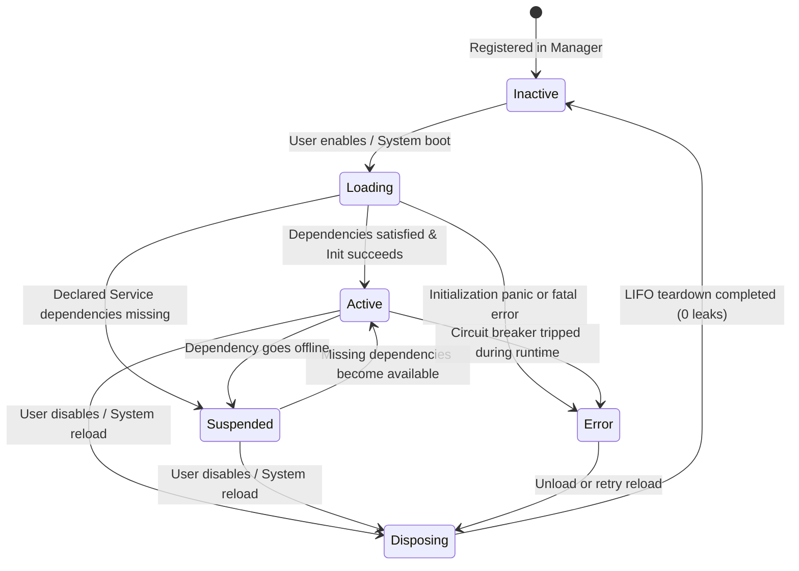

# Ani-Go Plugin Specification & Modern Architecture Blueprint

> **Version**: v0.6.2 (DSH / Cordis Architectural Evolution)  
> **Scope**: Ani-Go Microkernel Plugin Ecosystem  
> **Core Tenets**: Pure Go compilation, Zero CGO, Zero external runtime dependencies, Resident Memory < 30MB, Idle CPU 0.0%, Microkernel Purity

---

## 1. Architectural Philosophy & Background

Ani-Go strictly adheres to a **Microkernel Architecture**. The microkernel core is tightly scoped to the five-stage anime tracking and management pipeline:

```
RSS Fetching ──► Title & Episode Disambiguation ──► Downloader Scheduling (qB/Aria2) ──► Standard Renaming & Hardlinking ──► Jellyfin Library Refresh
```

All auxiliary capabilities outside this core pipeline (18-channel notification center, Bangumi/TMDB metadata mapping, local NFO scraping, standard renaming, third-party data migration) exist as **Plugins**.

### 1.1 The DSH / Cordis Architectural Paradigm

In modern highly extensible system architectures (such as DeepSeek Harness (DSH) and Cordis), a plugin system is not merely a collection of event listener callbacks. Instead, it is a **Spatiotemporal Composable Runtime** characterized by the following foundational tenets:

1. **Spatiotemporal Composability**:
   - **Spatial Dimension**: Each plugin operates within an isolated scoped context (`PluginContext` / Context Fork) derived from the root context, isolating internal state, registered resources, and log namespaces.
   - **Temporal Dimension**: Plugins can be loaded, activated, suspended, reloaded, or disposed of at any point in time during application runtime without restarting core processes or disrupting concurrent operations.
2. **Reversible Effects & Disposable Pattern**:
   - Any side effect generated by a plugin (registering event listeners, starting background goroutines, mounting pipeline interceptors, acquiring sockets or tickers) must be tied to a teardown closure (`Disposable`).
   - When a plugin is disabled or reloaded, the context automatically executes all teardown functions in **LIFO (Last-In, First-Out) reverse order**, completely eliminating dangling goroutines, duplicate event triggers, and orphaned memory allocations.
3. **Inversion of Control (IoC) & Declarative Dependency Injection**:
   - Plugins declare their service dependencies via `Dependencies()` (such as `database`, `downloader`, `metadata`) instead of reaching for global singletons.
   - The container orchestrates setup based on topological sort; if a required dependency goes offline, dependent plugins gracefully transition into a `Suspended` state until the dependency recovers.
4. **Dual-Track Processing: Pipeline Interceptors vs. EventBus Broadcast**:
   - **Synchronous Relay Track (Interceptors / Middlewares)**: Placed at critical microkernel execution nodes (such as anime naming or torrent filtering), allowing plugins to synchronously inspect, enrich, or veto/short-circuit operations.
   - **Asynchronous Broadcast Track (EventBus Pub/Sub)**: Pure decoupled unidirectional broadcasting for telemetry, audit logging, and external webhooks, equipped with panic isolation and non-blocking delivery.
5. **Strict Plugin Lifecycle State Machine**:
   - Replacing simple binary `bool` flags with a six-state machine: `Inactive` ➔ `Loading` ➔ `Active` ➔ `Suspended` ➔ `Error` ➔ `Disposing`, with real-time health visibility exposed to REST and MCP layers.

---

## 2. Architecture Contrast & Evolution Matrix

The table below contrasts Ani-Go's early plugin design, the modern DSH / Cordis paradigm, and Ani-Go's new pure-Go architectural evolution:

| Architectural Dimension | Ani-Go Early Design (v0.5.x) | DSH / Cordis Paradigm (TS/Dynamic) | Ani-Go Modern Evolution (v0.6.2+) |
|---|---|---|---|
| **Language & Runtime** | Pure Go, zero CGO, single binary | Node.js / TypeScript, dynamic runtime & GC | **100% Pure Go, zero CGO, zero heavy frameworks** |
| **Memory & CPU Budget** | ~25MB memory, 0.0% CPU idle | 80MB~200MB+ resident (V8 engine overhead) | **Strictly 15MB~30MB memory, 0.0% CPU idle** |
| **Resource Teardown** | Manually record `subID`, call `bus.Unsubscribe` in `Stop()`; prone to leaks | Automatically bound to `ctx.on('dispose', ...)` stack | **`PluginContext.OnDispose(fn)` stack, automatic LIFO execution** |
| **Goroutine Management** | Plugins spawn raw `go func()`, vulnerable to panics and leaks | Runtime-managed Promises & EventLoop microtasks | **`PluginContext.Go(worker)` managed workers with panic isolation & cancellation** |
| **Service Decoupling** | Plugins directly import and access global `database.DB` | Full IoC container with dynamic `ctx.inject` | **Lightweight `ServiceRegistry` via `ctx.GetService()`, no raw global access** |
| **Core Intervention** | Passive reaction after events occur; naming rules hardcoded | Onion-model middleware with sync intercept & mutate | **Dual-track: lightweight synchronous `Interceptor` chain + async `EventBus`** |
| **Lifecycle States** | Binary flag: `Enabled (true/false)`, blind to failures | Rich states: Loading, Running, Suspended, Error | **Six-state machine: `Inactive` / `Loading` / `Active` / `Suspended` / `Error` / `Disposing`** |
| **Dynamic Configuration** | Unstructured `settings` key-value pairs | Declarative Schema (JSON Schema / Formily) | **`ConfigSchema` metadata supporting dynamic frontend forms and validation** |

---

## 3. Modern Core Mechanisms Deep Dive

```
                   ┌────────────────────────────────────────┐
                   │          Ani-Go Microkernel            │
                   │  (Pure Go / Zero CGO / Memory < 30MB)  │
                   └──────────────────┬─────────────────────┘
                                      │
            ┌─────────────────────────┴────────────────────────┐
            ▼                                                  ▼
┌───────────────────────┐                          ┌────────────────────────┐
│  Synchronous Pipeline │                          │  Asynchronous EventBus │
│ (Interceptors Chain)  │                          │    (Pub/Sub Telemetry) │
├───────────────────────┤                          ├────────────────────────┤
│ [Filter Interceptors] │                          │ EventDownloadCompleted │
│ [Naming Interceptors] │                          │ EventFileOrganized     │
│ [Parser Interceptors] │                          │ EventSubscriptionAdded │
└───────────┬───────────┘                          └───────────┬────────────┘
            │                                                  │
            │                  PluginContext                   │
            │       (Scoped Hierarchy / Isolated Fork)         │
            ├──────────────────────────────────────────────────┤
            │  • OnDispose(fn) ───► LIFO Teardown Stack        │
            │  • Go(worker)   ───► Goroutine & Panic Isolation │
            │  • Inject(deps) ───► Service Registry Binding   │
            │  • Logger()     ───► Scoped Structured Logging   │
            └──────────────────────────┬───────────────────────┘
                                       │
            ┌──────────────────────────┴────────────────────────┐
            ▼                                                   ▼
┌───────────────────────┐                           ┌───────────────────────┐
│ BuiltIn Plugin Engine │                           │ Custom Webhook Plugin │
│   (In-Process Go)     │                           │   (HTTP Push, HMac)   │
└───────────────────────┘                           └───────────────────────┘
```

### 3.1 Scoped Context & Reversible Effects (`PluginContext` & Reversible Effects)

Every plugin receives a dedicated `PluginContext` upon activation. `PluginContext` inherits standard library `context.Context` and maintains an **undoable side-effect registry**:

```go
package plugin

import (
	"context"
	"log"

	"github.com/xiaoyueRX/Ani-Go/internal/core"
)

// Disposable represents a teardown closure function
type Disposable func()

// PluginContext defines the scoped context contract for plugins
type PluginContext interface {
	context.Context

	// Plugin metadata and scoped identity
	PluginID() string

	// 1. Reversible effect lifecycle management
	OnDispose(fn func())
	Dispose() // Executes all registered disposables in LIFO order

	// 2. Supervised goroutine management (bound to Context cancellation with panic isolation)
	Go(worker func(ctx context.Context))

	// 3. Auto-unsubscribed event subscriptions (no manual ID tracking required)
	Subscribe(eventType string, handler func(ev core.Event))

	// 4. Inversion of control: Service access and publication
	GetService(serviceType core.ServiceType) (interface{}, bool)
	MustGetService(serviceType core.ServiceType) interface{}
	ProvideService(serviceType core.ServiceType, impl interface{}) Disposable

	// 5. Synchronous pipeline interceptors (automatically unregistered on disposal)
	RegisterNamingInterceptor(priority core.HookPriority, name string, handler core.HookFunc)
	RegisterFilterInterceptor(priority core.HookPriority, name string, handler core.HookFunc)

	// 6. Scoped logger with plugin namespace
	Logger() *log.Logger
}
```

#### Zero-Leak Guarantees:
When a plugin is deactivated or hot-reloaded, `ctx.Dispose()` is called:
1. Immediately cancels the context via `context.CancelFunc`, propagating the teardown signal to all goroutines spawned via `ctx.Go(...)`;
2. Iterates in reverse over the `disposables` slice, running unsubscriptions, closing sockets, and clearing caches;
3. Resets internal pointers to `nil` for immediate garbage collection, guaranteeing **0 goroutine leaks, 0 lingering subscriptions, and 0 idle CPU usage**.

### 3.2 Inversion of Control & Service Registry (IoC & Service Registry)

To decouple plugins from global singletons (like `database.DB`), Ani-Go provides a lightweight, thread-safe Service Registry:

```go
type ServiceRegistry interface {
	Register(serviceType core.ServiceType, impl interface{}) Disposable
	Get(serviceType core.ServiceType) (interface{}, bool)
	Watch(serviceType core.ServiceType, callback func(available bool)) Disposable
}
```

Core services (`database`, `config`, `downloader`, `organizer`, `metadata`, `eventbus`, `ai`) are registered at boot. Plugins declare dependencies declaratively:
```go
func (p *MyPlugin) Dependencies() []core.ServiceType {
    return []core.ServiceType{core.ServiceDB, core.ServiceMetadata}
}
```
If a dependency becomes unavailable during runtime, the plugin automatically transitions into `Suspended` state, avoiding nil pointer exceptions.

### 3.3 Dual-Track Architecture: Pipeline Interceptors vs. EventBus

Ani-Go defines explicit boundaries between synchronous and asynchronous operations:

```
+-------------------------------------------------------------------------+
| [Pipeline] RSS Fetch ──► Filtering ──► Title Parse ──► Organize ──► Store|
+-------------------------------------------------------------------------+
           ▲                 ▲                ▲
           │                 │                │
  [Filter Interceptor]       │      [Naming Interceptor]
     (Sync veto/ad-block)    │         (Sync format/enrich path)
                             │
               [Parser Interceptor] (Self-healing disambiguation)
                             │
                             ▼
+-------------------------------------------------------------------------+
| [Broadcast Bus] EventBus (Pub/Sub: Async, Fire-and-Forget, Safe-Isolated)|
+-------------------------------------------------------------------------+
    │                        │                         │
    ▼                        ▼                         ▼
[Webhooks]           [Audit Logger]           [Notification Center]
```

- **Pipeline Interceptors**:
  - Purpose: Synchronously participate in execution flows (e.g. filtering torrents in `FilterInterceptor`, or custom formatting before hardlinks are created in `NamingInterceptor`).
  - Execution: Sequentially evaluated by `HookPriority`. Can mutate parameters or veto the operation.
- **EventBus Broadcasts**:
  - Purpose: Asynchronously notify listeners after state changes have completed (e.g. `download.completed`, `file.organized`).
  - Execution: Concurrently delivered across workers. Errors or slow handlers never block the main download pipeline.

### 3.4 Six-State Lifecycle Machine

Plugin runtime status is represented by an explicit state machine:



| State | Enum | Description |
|---|---|---|
| **Inactive** | `inactive` | Registered but not executing. 0 goroutines, 0 event listeners, minimal memory footprint. |
| **Loading** | `loading` | Validating configuration schema and verifying declared `Dependencies()`. |
| **Active** | `active` | Successfully initialized; interceptors and listeners active; background workers running. |
| **Suspended** | `suspended` | Enabled, but a declared dependency service is temporarily offline. Effects are dormant. |
| **Error** | `error` | Panic or fatal failure caught by the circuit breaker. Isolated to prevent core failure. |
| **Disposing** | `disposing` | Executing registered disposables in reverse order and cancelling contexts. |

---

## 4. Standard Interfaces & Type Contracts

### 4.1 Core Type Definitions

```go
package plugin

import "github.com/xiaoyueRX/Ani-Go/internal/core"

// PluginState represents the lifecycle status
type PluginState string

const (
	StateInactive  PluginState = "inactive"
	StateLoading   PluginState = "loading"
	StateActive    PluginState = "active"
	StateSuspended PluginState = "suspended"
	StateError     PluginState = "error"
	StateDisposing PluginState = "disposing"
)

// ConfigField describes configuration item metadata for frontend form rendering
type ConfigField struct {
	Key         string      `json:"key"`
	Label       string      `json:"label"`
	Description string      `json:"description"`
	Type        string      `json:"type"` // "string" | "number" | "boolean" | "select"
	Default     interface{} `json:"default,omitempty"`
	Options     []string    `json:"options,omitempty"`
	Required    bool        `json:"required"`
}

// PluginInfo represents plugin metadata exposed to web UI and MCP APIs
type PluginInfo struct {
	ID           string        `json:"id"`
	Name         string        `json:"name"`
	Description  string        `json:"description"`
	Version      string        `json:"version"`
	Author       string        `json:"author"`
	AuthorURL    string        `json:"author_url,omitempty"`
	Icon         string        `json:"icon"`
	State        PluginState   `json:"state"`
	LastError    string        `json:"last_error,omitempty"`
	IsBuiltIn    bool          `json:"is_builtin"`
	Type         string        `json:"type"` // "builtin" / "webhook"
	URL          string        `json:"url,omitempty"`
	Secret       string        `json:"secret,omitempty"`
	Events       []string      `json:"events"`
	ConfigSchema []ConfigField `json:"config_schema,omitempty"`
}

// ModernBuiltInPlugin defines the modern plugin contract
type ModernBuiltInPlugin interface {
	GetInfo() PluginInfo
	Dependencies() []core.ServiceType
	Init(ctx PluginContext) error
}
```

---

## 5. Low-Resource Environment Guarantees

Ani-Go is engineered to run on lightweight hardware such as Intel J1900, N3450, and Raspberry Pi 4B. The plugin subsystem guarantees:

1. **Strictly Zero CGO**:
   - `CGO_ENABLED=0` static compilation is mandatory. No C libraries or shared objects are permitted.
2. **Zero Bulky Runtimes**:
   - No embedded Node.js, V8, Python, or JVM instances. All capabilities are pure Go or lightweight HTTP Webhooks.
3. **Resident Memory & Idle CPU Budget**:
   - Idle resident memory (with all built-in plugins enabled and idle): **strictly 15MB ~ 30MB**;
   - While idle, plugin workers block on channels; **idle CPU usage remains constant at 0.0%**.
4. **Allocation Efficiency**:
   - Interceptors and events use pointers or shallow copies to minimize GC overhead.

---

## 6. Developer Walkthrough: Writing a Modern Plugin

The following example shows how to write a plugin that **synchronously formats filenames and asynchronously logs audit trails** using `PluginContext`:

```go
package plugin

import (
	"context"
	"fmt"
	"time"

	"github.com/xiaoyueRX/Ani-Go/internal/core"
)

// AuditAndNamingPlugin demonstrates the modern PluginContext architecture
type AuditAndNamingPlugin struct{}

func (p *AuditAndNamingPlugin) GetInfo() PluginInfo {
	return PluginInfo{
		ID:          "audit_and_naming",
		Name:        "Audit & Naming Interceptor",
		Description: "Modern architecture example: synchronous naming interceptor and asynchronous audit logger.",
		Version:     "1.0.0",
		Author:      "Ani-Go Team",
		Icon:        "ShieldCheck",
		IsBuiltIn:   true,
		Type:        "builtin",
		Events:      []string{core.EventFileOrganized},
	}
}

func (p *AuditAndNamingPlugin) Dependencies() []core.ServiceType {
	return []core.ServiceType{core.ServiceEventBus}
}

func (p *AuditAndNamingPlugin) Init(ctx PluginContext) error {
	logger := ctx.Logger()
	logger.Printf("🚀 Plugin started in scope: %s", ctx.PluginID())

	// 1. Register synchronous naming interceptor (auto-unregistered on dispose)
	ctx.RegisterNamingInterceptor(core.PriorityNormal, "audit_naming", func(c context.Context, input interface{}) (interface{}, error) {
		in, ok := input.(core.NamingHookInput)
		if !ok {
			return nil, fmt.Errorf("invalid naming input")
		}
		return core.NamingHookOutput{
			RenderedPath: "[AniGo-Verified] " + in.RenderedPath,
			Cancel:       false,
		}, nil
	})

	// 2. Subscribe to async EventBus events (auto-unsubscribed on dispose)
	ctx.Subscribe(core.EventFileOrganized, func(ev core.Event) {
		logger.Printf("📝 [AUDIT EVENT] File organized: %+v", ev.Payload)
	})

	// 3. Supervised background worker with panic isolation & cancellation
	ctx.Go(func(workerCtx context.Context) {
		ticker := time.NewTicker(10 * time.Minute)
		defer ticker.Stop()

		for {
			select {
			case <-workerCtx.Done():
				logger.Println("🛑 Background worker shutting down gracefully")
				return
			case t := <-ticker.C:
				logger.Printf("⏱️ [Heartbeat] Plugin alive at: %s", t.Format(time.RFC3339))
			}
		}
	})

	// 4. Custom cleanup hook (optional)
	ctx.OnDispose(func() {
		logger.Println("🧹 Cleaning up plugin temporary resources...")
	})

	return nil
}
```

### Registration:
Simply register in `internal/plugin/manager.go`:
```go
m.RegisterBuiltIn(&AuditAndNamingPlugin{})
```
No manual unsubscription or goroutine tracking is required; the runtime guarantees **zero leaks and zero residues**.

---

## 7. Custom Webhook Plugins & MCP Integration

For users who want external integration without rebuilding the Go binary:

### 7.1 Webhook Notification Protocol
Users register custom Webhook entries via the Web UI with `URL`, `Secret`, and subscribed event types.

```json
{
  "event": "download.completed",
  "timestamp": 1750000000,
  "plugin_id": "my_discord_bot",
  "payload": {
    "torrent_hash": "a1b2c3d4...",
    "anime_title": "Frieren: Beyond Journey's End",
    "episode": 12
  }
}
```

**Security & Delivery Guarantees**:
- **HMAC Signatures**: When a `secret` is provided, requests include `X-AniGo-Signature: sha256=<HMAC-SHA256>`;
- **SSRF Protection**: Private subnet addresses (`127.0.0.1`, `10.0.0.0/8`, `172.16.0.0/12`, `192.168.0.0/16`, cloud metadata services) are rejected by default;
- **Non-blocking Dispatch**: Dispatched within bounded worker pools with a 10s timeout, ensuring network stalls never block the download pipeline.

### 7.2 MCP (Model Context Protocol) Integration
Ani-Go provides a native SSE-based MCP server in `internal/mcp/`. External AI agents (Claude, Cursor) can query plugin statuses and trigger management actions via MCP tools.

---

## 8. Migration & Backward Compatibility Path

To ensure smooth transition without breaking existing built-in plugins:

1. **Bi-directional Legacy Adapter**:
   - Existing `BuiltInPlugin` implementations (`Init(bus, ctx)` and `Stop(bus)`) are wrapped transparently via `AdaptLegacyPlugin(p BuiltInPlugin) ModernBuiltInPlugin`;
   - The adapter extracts the EventBus in `Init(ctx PluginContext)` and registers the legacy `Stop()` method into `ctx.OnDispose(...)`.
2. **Progressive Migration Steps**:
   - **Phase 1**: Introduce `PluginContext`, `ServiceRegistry`, and the six-state machine in `internal/plugin/`;
   - **Phase 2**: Migrate built-in plugins (`MetadataMapping`, `GeekNaming`, `ExtendedNotifiers`, `NFOScraper`) to declarative `PluginContext`;
   - **Phase 3**: Update `SettingsPage.vue` to display six-state health badges and dynamic configuration forms.
